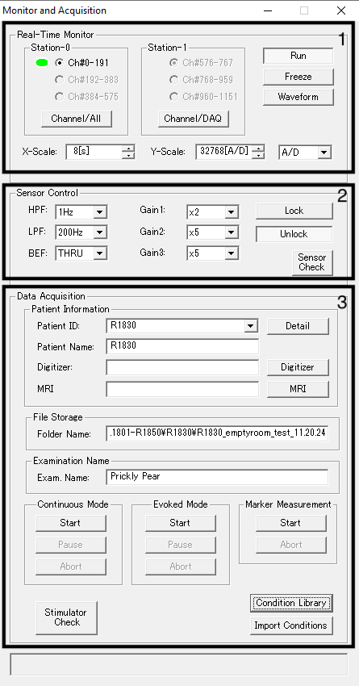
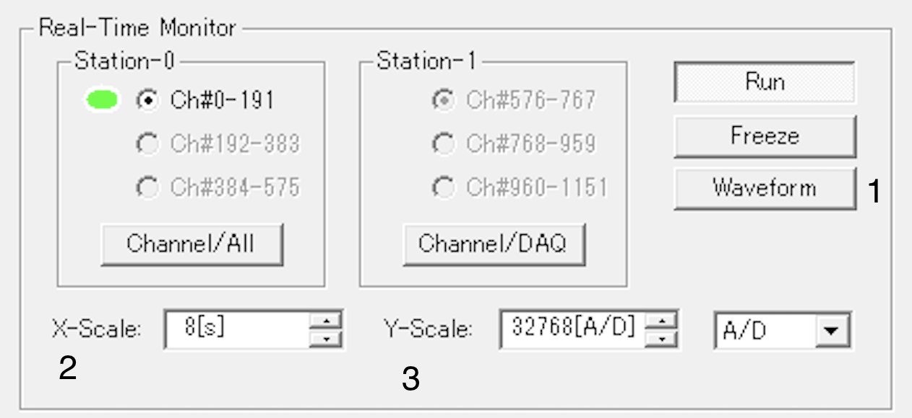
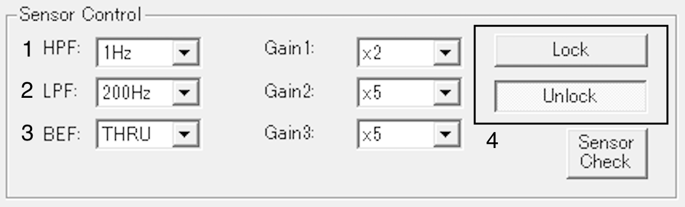
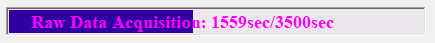
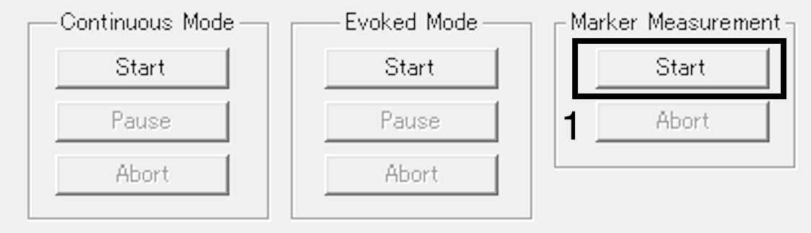
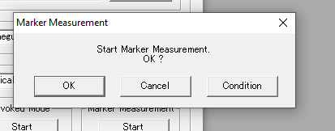
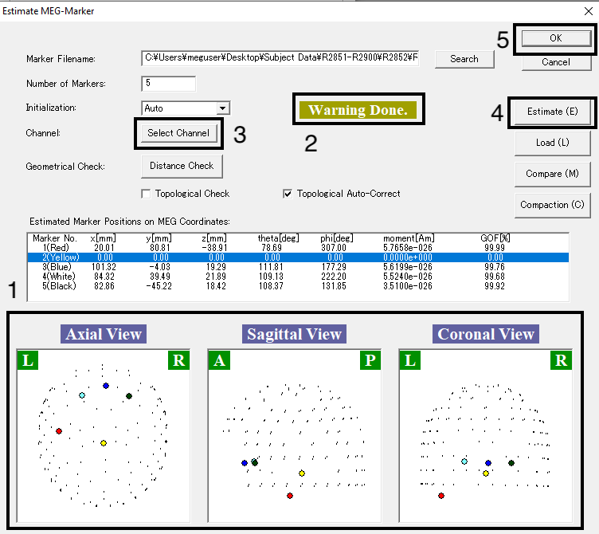
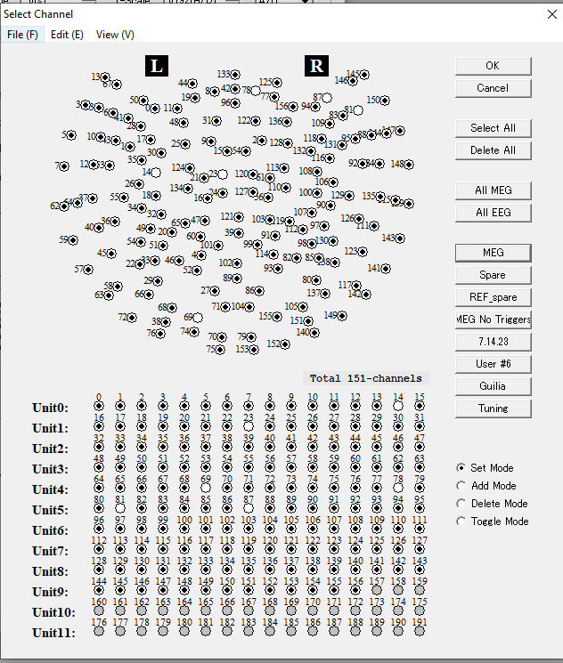

Once the room is setup and ready for a participant (see [Setup for Data Collection](Setup_Data_Collection.md) page) you will use the `MEG 160` program on the data acquisition computer to collect your data. 

This page goes through how to use `MEG 160` and the steps you should take to collect data when you have a participant. We recommend reading through the entire page while you are piloting your data. 

If you are running a participant, you can jump to the [Running a participant](#running-a-participant) section to make sure you are following all of the steps. 

## Table of contents
{: .no_toc .text-delta }
1. TOC
{:toc}

When running a participant, you want to complete the following steps: 
1. [Open MEG 160](#opening-meg-160)
2. [Autotune](#autotune)
3. [Open Data Acquisition Window](#data-collection)
4. [Set Parameters using a condition library](#setting-up-your-condition-library)
5. [Type in Participant ID and Folder](#data-acquisition)
6. [Lock the machine](#data-acquisition)
7. [Take Marker Measurements](#data-acquisition)
8. [Record](#data-acquisition)
9. [Take Marker Measurements again](#data-acquisition)

# Opening MEG 160

We use the software `MEG 160` to collect all data. To open the software, click on the MEG 160 icon located on the desktop:

*Insert image*
# Autotune

Autotuning should be done before every recording session and if there is a noise-burst during the recording. 

*Insert image*

# Data Collection

The data collection button opens up a window with all the parameters and functions you need to record data. The window looks like this:

*Insert image*

The sections below describe the function of all the parameters, how to set up a condition library for your experiment, and what to do when running a participant. 

## Sections of the Data Collection Window

The window consists of three sections:
1. Real-Time Monitor
2. Sensor Control
3. Data Acquisition. 

The parameters of each of these sections is described below. It is useful to familiarize yourself with these parameters before running participants. There are parameters that we often change, and ones we rarely touch—the ones we rarely touch are labeled as such. 

### Real Time Monitor

This portion of the window has parameters that control the display that you see on the large screen. You can tamper with these during a recording without affecting the recording itself.

1. **Waveform**: toggles how the sensors are displayed on the viewscreen. Either as: 1) a row per sensor; 2) a butterfly plot; 3) the sensors displayed with relation to the participants head. The easiest way to detect noisebursts is option (1). When demonstrating to participants, the display (3) is most intuitive. 
2. **X-scale**: the time-scale shown on the viewing screen. Typically set to 8s
3. **Y-scale**: The scale of fT shown on the viewing screen (toggles how big the recorded activity appears). I recommend setting this to 8129 to easily detect noisebursts, which at this scale appear as giant black blobs. 

This portion of the acquisition window likewise has the following parameters/buttons which we do not use. `Station-0/1` sections which are used to configure further channels, of which we only have 1-191 (so we never change these). The `run`, `Freeze`, and `A/D` buttons.

### Sensor Control

This set of parameters dictates the frequency at which activity will be recorded. This is most important set of parameters and should be carefully decided on before running any subjects.

1. **HPF**: High Pass Filter. Filter out all data at a higher frequency than the one specified. For example, a high-pass filter of 0.1 Hz allows waves with a frequency of ≥ 0.1 Hz to pass. 
2. **LPF**: Low Pass Filter. Filter out all data at a lower frequency than the one specified. For example, a low-pass filter of 200 Hz allows all waves with a frequency of ≤200 Hz to pass.
3. **BEF**: Band-Elimination Filter. This is always set to `THRU`
5. **Lock/Unlock**: These buttons lock/unlock the feedback loop of the SQUID electronics. This essentially "activates" the sensors, making them ready to acquire data.
    - **Always have sensors unlocked when opening the MEG door**. Otherwise environmental noise can blow one of the sensors, leading to permanent damage. 
    - Always have sensors locked when recording data. 

The HPF and LPF parameters are online filters. Read the Online Filters section for more information and considerations on how to set these. 

There are additional parameters of `Gain1-3` which set signal amplification factors and a `Sensor Check` which checks sensor. These parameters are not used as often.

### Data Acquisition

This portion of the acquisition window is dedicated to the actual data acquisition, i.e. starting and stopping the recording. 

1. **Patient Information**: Set `Patient ID` and `Patient Name` to your participant R-Number. This will properly label meta-data associated with your recording. 

2. **File Storage**: `Folder Name` should be set to the path of the folder where you would like your data to be saved to. Note that marker measurements are automatically saved to this specified location.

3. **Examination Name**: Set `Exam. Name` to the unique name of your experiment (e.g. "Prickly Pear") to properly label meta-data associated with your recording. 

4. **Continuous Mode**: These are the buttons associated with collected continuous data, i.e. the type of data we predominantly record. 
    - `Start`: ????
    - **Add Something About Dialogue Box**
    - `Change`: Change the frequency and/or maximum time of the recording. If your participant is taking longer in a task than expected, and the max time is running out—you can click and change the max time during the recording. 
    - `Abort`: This ends the continuous recording and automatically opens a window to allow you to save it. Despite the name, this is the button you click to save your data!

5. **Marker Measurements**: These are the buttons you use to take marker measurements. See section [Marker Measurements](#marker-measurements) for more details.
    - `Start`: Start the marker measurement recording
    - `Abort`: Stop the marker measurement recording

6. **Condition Library**: Automatically sets the parameters of your recording. See the section on [condition libraries](#setting_up_your_condition_library) for more details. 

7. **Data Acquisition Time**: While you are recording, this bar will tell you how many seconds out of the max recording time you set when you started the recording. See the image below for reference. Note that if the recording time hits the max, the recording will automatically stop. So be sure to monitor this during your experiment. If the recording time is nearing the maximum limit you set, you can either pause the experiment and save the data, or click `change` and change the maximum limit. 

## Setting up your Condition Library

The condition library allows you to save all of your recording parameters so that you don't have to manually input them every time you run a new participant. *It is highly recommended to set a condition library before your first participant and use it for all of your participants.*

*Insert Image*

**To set up a condition library**, first manually input all of your desired parameters into the `Real Time Monitor` and `Sensor Control` sections. The `Data Acquisition` section has to manually be filled out every time you run a participant. Once those parameters are filled in, click on `Condition Library`. Condition Libraries are alphabetically listed. Open up the set with the first letter of your experiment name. Select an open slot (e.g. "untitled 03"). Click `load` and then `yes`. This will prompt you for a name of the new condition library. Type in the name of your experiment. 

**To load a condition library**, select `Condition Library`. Navigate to 

## Marker Measurements

Marker Measurements are recordings taken from the 5 markers taped to the participants scalp. The record where the participant's head is in space relative to the MEG sensors. We use these measurements to align the participant's head-shape (where the five fiducials were scanned using the FastScan scanner) with the recording of their brain activity. 

**Marker Measurements should be taken before and after every recording**

To take a marker measurement, click the `start` button under the `marker measurements` section of the MEG160 acquisition window. 

MEG 160 will prompt you as to whether you want to start the measurement. Click `Ok`. 

Once the marker measurement is taken, the following window will appear:

1. **Marker Measurement View**: This visuals show you the localtion of the markers relative to the MEG sensors. Visually inspect the output to see whether there are any issues. As you can see in this example, the yellow marker is off. 

2. **Notes on the Measurement**: This area tells you whether the marker measurements were computed correctly. If they are, this box will appear dark green. If they are not, as in this example, it say `Warning done`. 

3. **Select Channel**: This button opens a new window that allows you to select which channels to use when estimating the marker locations in space. It is highly recommended that you **select a subset of the channels to compute the marker measurements, regardless of whether they initially look well positioned or not.** We have several faulty channels on the MEG that we do not want used in the calculation. See below on how to do this. 

4. **Estimate**: This button re-estimates the marker locations. **This should be done every time you re-select channels**

5. **Ok Button**: The ok button automatically saves the marker measurements to the path you input into the main MEG 160 data acquisition window. 

Once you click the `Select Channel` button, the window below will pop up. In this window, select which channels you want to be used to estimate the marker positions in space. We usually use the `MEG` button, which automatically deselects channels 14, 23, 78, 81, 87—all of which have been known to cause problems when estimating marker measurements. 

**What if selecting `MEG` does not solve the issues with the marker measurements?**

There are a couple possibilities:
- Try de-selecting more channels (note that you can do this offline, just save the marker measurements, and then do this when the participant is not in the MEG)
- A marker coil fell of the participants head 
- One of the marker coils stopped working

Regardless of what the issue is, if you have at least 3 markers that are properly estimated—that suffices to reconstruct the position of the participants head in space. 